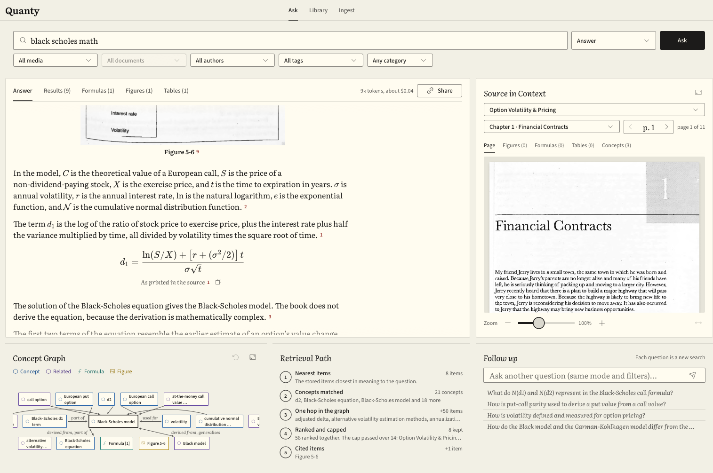
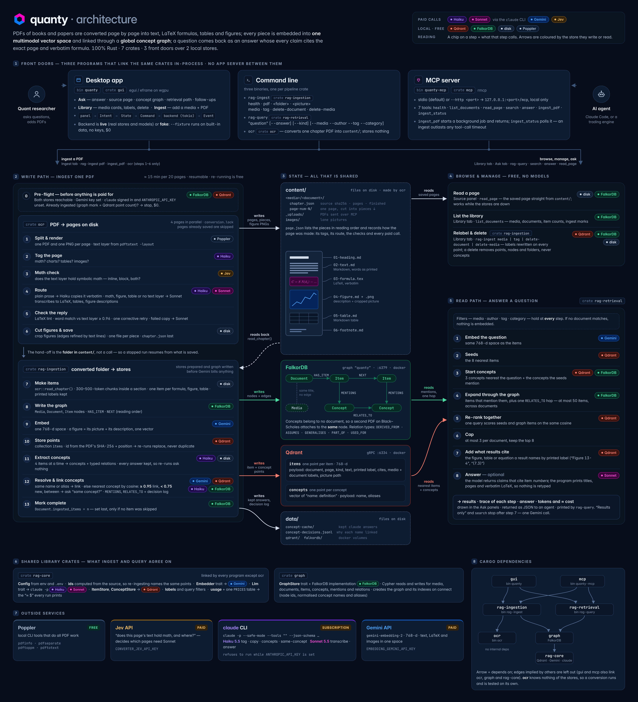

<h1 align="center">quanty</h1>

<p align="center">
  <b>A multimodal RAG over the PDFs of quant finance books and papers.</b><br>
  A desktop app for people, an MCP server for agents, and a command line, all in Rust.
</p>

<p align="center">
  <a href="#quickstart">Quickstart</a> ·
  <a href="#the-desktop-app">Desktop app</a> ·
  <a href="#mcp-server">MCP server</a> ·
  <a href="#command-line">Command line</a> ·
  <a href="#costs">Costs</a> ·
  <a href="#troubleshooting">Troubleshooting</a> ·
  <a href="docs/reference.md">Reference</a>
</p>

<p align="center">
  
  <br>
  <sub>The desktop app on its built-in <code>black-scholes</code> fixture: sample data, no store, no model, no cost.</sub>
</p>

## Choose a model

The **Model** and **Thinking** dropdowns in the desktop top bar are for the tab on screen. Ask,
Ingest and Datasets each keep their own Model and Thinking choice, which the top bar shows on that
tab; Library has none. Ask is for answers, Ingest for page conversion and concept extraction, and
Datasets for dataset builds. The default is **Codex / GPT-6.1 Sol / Medium**. Claude models remain
in the same menu. The controls use the app's existing dropdown styling and save immediately;
finish any running operation before switching.

All language-model calls run headlessly through the installed CLI. Run `codex login` once
with your ChatGPT account, or sign in with `claude` when using Claude. No OpenAI API key is
needed. Codex CLI 0.162.1 is tested; it must support `--ignore-user-config` and `--ignore-rules`.

The saved choices are `.quanty-model.json` in the Quanty home folder. The file holds `ask`,
`ingest` and `datasets`, one choice for each kind of work, each with `provider`, `model` and
`thinking`. The desktop app, command line tools, OCR and MCP server read it before creating a model
client, so no restart is needed. `rag-query` and the MCP `search` and `answer` tools use the Ask
choice. `rag-ingest` (concepts, the insights of a chapter, `pdf`, `insights` and `health`), page
conversion (`ocr` and the app's ingest) and the MCP `ingest_pdf` and `health` tools use the Ingest
choice. `rag-dataset` and the MCP `build_dataset` tool use the Datasets choice. A file saved by an
older version of quanty holds one choice and gives it to all three until a tab is changed; the next
save writes the three choices. An MCP server that is still running from an older version must be
restarted. Without that file, `LLM_PROVIDER`, `LLM_MODEL` and `LLM_THINKING` in the environment or
`.env` set the defaults, the same for all three. A saved UI choice takes precedence. Codex defaults
to `gpt-6.1-sol` with `medium` thinking. Supported levels are `low`, `medium`, `high`, `xhigh`,
`max` and, for models that support it, `ultra`. `CODEX_BIN` can name a custom Codex executable.

PDF pages are rendered locally and attached as images, with their text layer, to headless
Codex. No model shell tools are needed. Gemini embedding and Jev conversion settings keep
their existing roles. Codex usage records tokens; dollar cost is unknown when no price is
available. [Codex non-interactive mode](https://learn.chatgpt.com/docs/non-interactive-mode)
describes the CLI protocol.

## Why quanty

On their own, LLMs cannot be trusted to automate post-trade analysis research: they hallucinate math and are not (yet) masters of quantitative trading end to end. A quant research team can instead give its agents a trusted knowledge base that it owns as its IP and moat.

quanty is an open-source answer:

- Give it PDFs of books and papers.
- Its OCR layer, run entirely by the software, uses Jev to find the math and the selected Codex or Claude model to write it as LaTeX and describe each figure.
- Everything is embedded into a multimodal RAG database and linked by concept, so the connections grow with the knowledge base.
- It is 100% Rust, the UI included.

A person can ask it "what is the correct math for a multivariate Hawkes process and how has it been used to improve volatility forecasting?", and an agent can ask the same over MCP for a post-trade analytics or trading engine. The knowledge is not magically there: the business builds it. The point is that you know the math comes from data you gave. quanty also builds training datasets for a company's own LLMs, such as Gemma 4, from the same converted documents: `rag-dataset`, the **Datasets** tab and the `build_dataset` tool. [docs/training.md](docs/training.md) says how to train on them.

Whether the goal is maximising Sharpe ratio, increasing trade volume or reducing risk, quanty is a stepping stone between the robust modelling quant finance requires and the accelerating progress of QIS.

## Try it in one command

With Rust installed and nothing else (no keys, no Docker), run this in the quanty folder, the root of this repository:

```bash
cargo run --release -p gui -- --fixture black-scholes
```

It opens the app shown above on its built-in sample data. `--fixture list` names the other scenes.

People use the [desktop app](#the-desktop-app), agents use the [MCP server](#mcp-server), and there is a [command line](#command-line). All three read the same stores, so set them up once, as the [Quickstart](#quickstart) shows.

## Quickstart

Set up once, then open the app with real stores. Run every command in the quanty folder.

### 1. Install the tools

| You need                                                             | What it is for                                                                |
| -------------------------------------------------------------------- | ----------------------------------------------------------------------------- |
| Rust (stable, with `cargo`)                                          | Builds every program                                                          |
| Docker, with `docker compose`                                        | Runs the two stores: Qdrant (vectors) and FalkorDB (the graph)                |
| [Poppler](https://poppler.freedesktop.org/) (`brew install poppler`) | Reads a PDF when it is converted                                              |
| The `codex` CLI, signed in (or `claude`)                                          | Reads pages, finds concepts and writes answers, on the subscription of each agent you choose |

### 2. Start the stores

Make sure Docker is running: start Docker Desktop, then start the two stores.

```bash
docker compose up -d    # Qdrant on ports 6333 and 6334, FalkorDB on 6379, data under data/
docker compose ps       # both quanty-qdrant-1 and quanty-falkordb-1 say running
```

### 3. Add the keys

Copy the example and put your two keys in it.

```bash
cp .env.example .env       # then put your two keys in place of PLEASE_PROVIDE and ENTER
unset ANTHROPIC_API_KEY    # must not be set, so that claude bills your subscription, not the API
```

| Key                        | What it is for                                                                      |
| -------------------------- | ----------------------------------------------------------------------------------- |
| `EMBEDDING_GEMINI_API_KEY` | Gemini embeddings: it embeds every page and every question                          |
| `CONVERTER_JEV_API_KEY`    | The Jev API, which is asked whether a page holds math: only when a PDF is converted |

> [!IMPORTANT]
> `ANTHROPIC_API_KEY` must not be set, in the shell or in `.env`. When Claude is selected and it is set, quanty asks `claude` nothing, so that the work is billed to the subscription and not to the API. `unset ANTHROPIC_API_KEY` does nothing when it is not set.

### 4. Check the services

```bash
cargo run --release -p rag-ingestion --bin rag-ingest -- health
```

`health` prints one line each for Qdrant, FalkorDB and the agent of the Ingest choice: `ok`, or `FAILED` with what is wrong. It does not check the Gemini or Jev keys. When the Ingest choice is Claude, it refuses `ANTHROPIC_API_KEY`; Codex requires a ChatGPT subscription login.

### 5. Open the app

```bash
cargo run --release -p gui
```

The window opens on **Ask**. Add your first PDF on the **Ingest** tab, or from the command line as [Add your first PDF](#add-your-first-pdf) shows. When a store, a key or `claude` is not ready, the part of the window that needs it says which one and what to do.

## Add your first PDF

The library holds media. A media is a book, a paper or another work, with a title, a category, its authors and its tags. Each PDF is one document of a media, and a document can also have tags of its own.

| Document                                                  | Its PDF                                                                                                                 |
| --------------------------------------------------------- | ----------------------------------------------------------------------------------------------------------------------- |
| A chapter of a book                                       | Named `chapter-<number>-<name>.pdf`                                                                                     |
| A part of a book that is not a chapter, such as its index | Any name. It takes a title instead: `--title` on the command line, `document_title` over MCP, **Other part** in the app |
| The PDF of a paper or another work, which has a title     | Any name                                                                                                                |

The repository holds a sample of seven pages. Ingest it, then ask a question. The ingest is paid work: see [Costs](#costs).

```bash
cargo run --release -p rag-ingestion --bin rag-ingest -- pdf \
  --book "Option Volatility and Pricing" \
  --author "Sheldon Natenberg" --tag options \
  samples/chapter-1-sample-pages.pdf

cargo run --release -p rag-retrieval --bin rag-query -- "What is the Black–Scholes formula for a call option?"

# Ask one document alone, by its stored title or its document id
cargo run --release -p rag-retrieval --bin rag-query -- --document "Option Volatility and Pricing, chapter 1: Sample Pages" "Which pages cover volatility?"
```

A 20-page PDF takes about 15 minutes. If it stops, run the same command again and it carries on. On a finished PDF it does nothing and costs nothing, unless the chapter has no insights yet: then it writes only those.

Every chapter or paper that is ingested also gets a file, `insights.json`, in its folder under `content/`. The model of the Ingest choice writes it from the whole converted text: the insights (short paragraphs, each with the pages it rests on), the takeaways (one line each) and a cheat sheet (headed sections, formulas and small tables). A chapter that has the file is not asked again. A part of a book that is not a chapter, such as its index, table of contents, front cover, glossary or preface, gets none, because it has no argument to summarise: the run says so and asks the model nothing. A paper does get them. A picture that stands alone gets none. Chapters that were ingested before this existed get theirs with `rag-ingest insights`; see [the command](docs/reference.md#writing-the-insights-of-stored-chapters).

<details>
<summary>What the ingest prints while it runs</summary>

Its progress goes to standard error, one line for each step. The summary comes last, on standard output.

1. `checking what is already stored`
2. `opening the pdf`
3. `converting 7 of 7 pages (0 already done)`
4. One line for each page as it is cut out, such as `page 3 cut out`
5. One line for each page with what the page cost, such as `page 3 converted ($0.14)`
6. `writing the graph`
7. `embedding <n> items`
8. `storing the items`
9. `writing the insights, takeaways and cheat sheet`
10. `reading the concepts of <n> items`
11. `linking the concepts of <n> items`

Every line, and when it shows, is in [docs/reference.md](docs/reference.md#ingesting-a-pdf).

</details>

The PDF of a paper can have any name, and a paper often has more than one author:

```bash
cargo run --release -p rag-ingestion --bin rag-ingest -- pdf \
  --paper "Hawkes Processes in Finance" \
  --author "First Author" --author "Second Author" --tag hawkes \
  --doc-tag survey \
  path/to/hawkes-notes.pdf
```

A part of a book that is not a chapter, such as its index, takes `--title`, and its PDF can have any name. The document is stored as the title of the book, a comma and the title of the part, here `Option Volatility and Pricing, Index`, and the Library lists it by its own title, after the chapters:

```bash
cargo run --release -p rag-ingestion --bin rag-ingest -- pdf \
  --book "Option Volatility and Pricing" --title "Index" \
  path/to/book-index.pdf
```

Three flags label what you ingest. All three are optional.

| Flag        | What it labels                                       |
| ----------- | ---------------------------------------------------- |
| `--author`  | An author of the media. Give it once for each author |
| `--tag`     | A tag of the media                                   |
| `--doc-tag` | This PDF only                                        |

`--author` and `--tag` are used only when the library does not have that media yet: change a stored media with `rag-ingest media`. A media that the library already has keeps its own category, whatever `--book`, `--paper` or `--other` says.

## Architecture

The whole system on one page: how a PDF becomes items, concepts and points, and how a question comes back as an answer with citations.

<p align="center">
  
</p>

What each crate is, and how a search works step by step, is in [docs/reference.md](docs/reference.md#how-it-works). The folders of the repository:

| Folder      | What it holds                                                                                                                                                                   |
| ----------- | ------------------------------------------------------------------------------------------------------------------------------------------------------------------------------- |
| `crates/`   | Ten crates: `ocr`, `rag-core`, `model-settings`, `graph`, `rag-ingestion`, `rag-retrieval`, `rag-dataset`, `export`, `gui` and `mcp`                                            |
| `docs/`     | [reference.md](docs/reference.md), every command in full, [mcp.md](docs/mcp.md), the MCP server in full, and [training.md](docs/training.md), how to train Gemma 4 on a dataset |
| `samples/`  | The sample PDF and converted sample chapters                                                                                                                                    |
| `content/`  | The converted documents, in one folder for each media. Made on your machine, not in git                                                                                         |
| `data/`     | The stores and the kept answers. Made on your machine, not in git                                                                                                               |
| `datasets/` | The built training datasets (`DATASET_DIR`). Made on your machine, not in git                                                                                                   |

## The desktop app

The app is for people. It opens one window with four tabs: **Ask**, **Library**, **Ingest** and **Datasets**.

```bash
cargo run --release -p gui    # builds and opens target/release/quanty
```

The six panels of Ask, every button and every key are in [docs/reference.md](docs/reference.md#the-desktop-app). Not built yet: the notices tray, the help sheet and the health check.

<details>
<summary>Keys</summary>

| Key                                         | What it does                                                    |
| ------------------------------------------- | --------------------------------------------------------------- |
| <kbd>⌘1</kbd> to <kbd>⌘4</kbd>              | Go to **Ask**, **Library**, **Ingest**, **Datasets**            |
| <kbd>/</kbd> or <kbd>⌘K</kbd>               | Write a question (<kbd>Enter</kbd> asks it)                     |
| <kbd>J</kbd>, <kbd>K</kbd>                  | Next and previous result                                        |
| <kbd>⌘.</kbd> or <kbd>Esc</kbd>             | Stop the search or the answer                                   |
| <kbd>Esc</kbd>                              | Put a maximised panel back, when no search or answer is running |
| <kbd>⇧⌘S</kbd>                              | Copy the answer with its citations                              |

</details>

### Ask

- Ask a question in the mode **Answer** or **Results only**, with five filters: **Media**, **Document**, **Authors**, **Tags** and **Category**.
- Read the answer with its citations, the page each citation stands on, the concept graph, the steps of the search, and questions to ask next.
- **Answer** costs one Gemini embedding call and one call to the selected model on your selected agent subscription. **Results only** writes no answer and costs the embedding call alone.
- **Maximise**, at the top right of the page's panel and of the concept graph, gives that panel the whole tab. **Restore**, in the same place, puts every panel back.
- **Share** opens a menu: **Copy as Markdown**, or **Export as PDF…**, **Export as Markdown…** and **Export as HTML…**, which save the written answer, with its formulas, figures, tables, code and sources, as one file that stands alone. An export is free.

### Library

- A shelf on the left with a **Find** box and one row for each media, with how many documents it has. Only the open media shows its documents, so a media and one of its chapters are two clicks away, however large the library is.
- The page of a media shows its title, a badge for its category, its authors and its tags. Its pencil, **✎ Edit**, changes the category, the authors and the tags, as `rag-ingest media` does. The title cannot change, because it names the media's folder.
- The page of a document shows its chapter or its title, its pages and its items, and a strip of views: Overview, Insights, Code, Formulas, Figures, Tables and Concepts. Only the Overview is built so far. It shows the document's own tags and the buttons: **Copy id** copies its document id, which `rag-ingest tag` and `rag-ingest delete-document` take, **Read** opens it in Ask, **Edit tags** changes its own tags, as `rag-ingest tag` does, and **Delete** deletes it.
- **Delete** on the page of a media deletes the media with every document of it. A sheet asks first, and a delete cannot be undone. It does what `rag-ingest delete-document` and `rag-ingest delete-media` do, and it never removes the PDF you picked from your own disk.
- Every edit and every delete is free. **Delete** is off while a dataset is being built.

### Ingest

- The **Add media** journey. Choose a media in the **Media** list, or choose **Add new media…**, pick its category, type its title, authors and tags, and press **Save media**.
- Press **Choose a PDF**. For a book, **Part of the book** offers **Chapter** and **Other part**. A chapter's number and name are filled in from a file named `chapter-<number>-<name>.pdf`. An other part, such as the index or the glossary, takes a **Title**. **Tags for this PDF** are the document's own tags.
- The check then runs by itself and is free: it says how many pages the PDF has and how many are converted already, or what would stop a start. For a chapter that is stored but has no insights yet, it says that a start pays only for the insights, takeaways and cheat sheet; for a part of a book that is not a chapter it says that a start pays for nothing.
- **Start ingest** is paid work, the same as `rag-ingest pdf`. Keep the app open while it runs; if it stops, start the same PDF again and it carries on. **Add another PDF** keeps the media chosen for the next PDF.

<details>
<summary>What the <b>Ingest</b> bar shows while it runs</summary>

The bar shows the stage and how far it has got:

1. "Checking what is already stored" and "Opening the PDF"
2. "Preparing the pages — 7 of 12 ready · about 9%"
3. "Converting the pages — 3 of 12 done · about 36%", with what the pages have cost so far
4. The later stages, such as "Writing the insights, takeaways and cheat sheet", up to "Linking the concepts"

The percent is an estimate: it runs from the first page cut out to the last page saved.

</details>

### Datasets

- Fill in a form: the dataset's name, **Media** (or **All media**), the documents to hold out of training, the rewrites and the questions per section, the most SFT examples, and a dry-run box. The other options keep the defaults of `rag-dataset build`.
- **Start build** is paid work on the model chosen in the top bar, the same as `rag-dataset build`. Tick the dry-run box and it is free: it exports, checks and plans, and asks no model.
- While it runs the bar shows the stage in words with "about N%" and the spend so far. At the end a notice gives the counts and the dataset's folder, and **Try again** or **Build another** goes on from there.

## MCP server

`quanty-mcp` is a [Model Context Protocol](https://modelcontextprotocol.io) server over the same stores, for agents. Build it and add it to Claude Code, with both lines run in the quanty folder.

```bash
cargo build --release -p mcp    # makes target/release/quanty-mcp
claude mcp add --scope user quanty -- sh -c "cd '$PWD' && exec '$PWD/target/release/quanty-mcp'"
```

The server finds `.env`, `content/` and `data/` from the folder it starts in: that is what the `cd` is for.

| Tool             | What it does                                                     | Cost                                               |
| ---------------- | ---------------------------------------------------------------- | -------------------------------------------------- |
| `health`         | Says whether Qdrant, FalkorDB and the sign-in of the Ingest choice's agent are ready | Free                                               |
| `list_documents` | Lists every stored document                                      | Free                                               |
| `search`         | Finds the stored items nearest to a question                     | One small Gemini call                              |
| `read_page`      | Reads one page of a document, in reading order                   | Free                                               |
| `answer`         | Writes an answer from what `search` finds, with its sources      | A Gemini call and the subscription usage of the agent of the Ask choice |
| `ingest_pdf`     | Converts one PDF of a media and stores it                        | Paid and slow: the agent of the Ingest choice, Jev and Gemini  |
| `ingest_status`  | Says how an ingest job is going                                  | Free                                               |
| `build_dataset`  | Builds a training dataset from the converted documents           | Paid and slow, it can take hours, unless `dry_run` is `true`, which is free |
| `dataset_status` | Says how a dataset build is going and what it spent so far       | Free                                               |

An agent that can write its own answer should call `search`, not `answer`. The arguments, the first calls to try, `.mcp.json`, HTTP, how to send a PDF and how to build a dataset are in [docs/mcp.md](docs/mcp.md).

## Command line

Four programs. Every command and flag is in [docs/reference.md](docs/reference.md).

| Program       | What it does                                                                                                                                                                                                                                                           |
| ------------- | ---------------------------------------------------------------------------------------------------------------------------------------------------------------------------------------------------------------------------------------------------------------------- |
| `rag-ingest`  | Checks the services, ingests a PDF or a converted document, writes the missing insights of stored chapters (`insights`), changes a media (`media`) or the own tags of a document (`tag`), and deletes a document (`delete-document`) or a whole media (`delete-media`) |
| `rag-query`   | Asks the stored items of the whole library, or of one document (`--document`), a question, and `--answer` writes an answer                                                                                                                                             |
| `ocr`         | Converts the PDF of a book's chapter into saved files under `content/`, and stores nothing                                                                                                                                                                             |
| `rag-dataset` | Builds a training dataset for Gemma 4 from the converted documents; `--dry-run` plans it for free                                                                                                                                                                      |

Run each one through `cargo`:

```bash
cargo run --release -p rag-ingestion --bin rag-ingest -- …
cargo run --release -p rag-retrieval --bin rag-query -- …
cargo run --release -p ocr -- …
cargo run --release -p rag-dataset -- build --name <name> …
```

The recipe for training on a dataset is in [docs/training.md](docs/training.md).

## Costs

These bill for the work that quanty asks of them.

| What                        | Billed to                                                | When                                                                                          |
| --------------------------- | -------------------------------------------------------- | --------------------------------------------------------------------------------------------- |
| Gemini embeddings           | Your Gemini API key, by the token                        | Every ingest and every question                                                               |
| Jev                         | Your Jev API key                                         | The pages of a PDF, when they are converted                                                   |
| `claude` (Haiku and Sonnet) | The subscription `claude` is signed in to, never the API | Converting pages, finding concepts, writing the insights of a chapter and writing an answer   |
| A dataset build             | The subscription of the agent of the Datasets choice, Codex or Claude | `rag-dataset build`, `build_dataset` and **Start build** on the Datasets tab, never a dry run |

Every ingest and every question reports the tokens each model used and about what they cost, such as `cost of this run: ≈ $1.75`. The figure comes from one table of prices per million tokens: it is what the API would charge, not what your subscription bills. The table, its date and how each figure is made are in [docs/reference.md](docs/reference.md#costs).

Converted pages and the answers about concepts are kept on disk, so a run that stopped goes on without paying twice, and a PDF that is already ingested costs nothing once its `insights.json` is saved. `rag-ingest insights` is paid work too, for each chapter whose file is missing, unless it is a dry run. The answers of a dataset build are kept in `DATASET_CACHE_DIR`, so a build asked again does not pay twice. `rag-ingest pdf` checks the Gemini key and both stores before the first page is paid for.

These cost nothing:

- The two stores, which run on your machine.
- `health`, `--fixture`, `list_documents`, `read_page`, `ingest_status`, `dataset_status`, `media`, `tag`, `delete-document`, `delete-media` and `insights --dry-run`.
- A dry run of a dataset: `rag-dataset build --dry-run`, `dry_run: true` in `build_dataset`, and the dry-run box of the Datasets tab.
- The check, every edit and every delete of the desktop app.

`delete-document`, `delete-media` and a delete in the desktop app cost nothing to run, but they remove the converted pages, so the same PDF ingested again is converted again, which is paid work.

## Start fresh

To empty the library and begin again, stop the stores and remove the two folders that quanty made on your machine.

> [!CAUTION]
> This deletes every stored media and document, every converted page (with the PDFs that the MCP server saved under `content/_uploads`), every kept answer about concepts, every kept answer of the dataset builds, and the log of concept decisions. It cannot be undone.

```bash
docker compose down       # stops Qdrant and FalkorDB
rm -rf data content       # the stores, the kept answers and the converted documents
docker compose up -d
cargo run --release -p rag-ingestion --bin rag-ingest -- health
```

Nothing in git is touched: `samples/` stays. To ingest the PDFs again is paid work again, because nothing is kept to go on from: see [Costs](#costs). The built datasets are in `datasets/`, which `rm -rf data content` leaves: remove it too to drop them. The kept answers of their models are in `data/dataset-cache`, so they go with `data`, and a dataset built again is paid work again. When `.env` names other places with `CONTENT_DIR`, `CONCEPT_CACHE_DIR`, `CONCEPT_DECISION_LOG`, `DATASET_DIR` or `DATASET_CACHE_DIR`, remove those too.

## Troubleshooting

Messages you may see, and what to do.

| What you see                                                                                                                                                             | What to do                                                                                                                                                                                                                                                                                                            |
| ------------------------------------------------------------------------------------------------------------------------------------------------------------------------ | --------------------------------------------------------------------------------------------------------------------------------------------------------------------------------------------------------------------------------------------------------------------------------------------------------------------- |
| `could not reach Qdrant at …` or `could not connect to FalkorDB at …`                                                                                                    | Run `docker compose up -d`, then `health` again                                                                                                                                                                                                                                                                       |
| `did not answer like FalkorDB; another program may be using that port`                                                                                                   | Something else listens on port 6379, such as a local Redis. Stop it, or map the container to another port and set `FALKORDB_URL` to match                                                                                                                                                                             |
| `EMBEDDING_GEMINI_API_KEY is not set` or `CONVERTER_JEV_API_KEY is not set`                                                                                              | Put the key in `.env`, and start the command in the quanty folder: `.env` is looked for in the current folder and the folders above it                                                                                                                                                                                |
| `ANTHROPIC_API_KEY is set, so claude could bill the API` or `claude is not signed in`                                                                                    | Run `unset ANTHROPIC_API_KEY`, or run `claude` in a terminal and sign in. Then start the program again                                                                                                                                                                                                                |
| "The page was not found" in the app, or `no converted chapter under content has the document id …` from `read_page`                                                      | The document's folder is not where quanty looks. Put it inside its media's folder under `content/`, or ingest its PDF again with `rag-ingest pdf`                                                                                                                                                                     |
| `… cannot be ingested as a book chapter; rename it to chapter-<number>-<name>.pdf …` or `… so its pdf must be named chapter-<number>-<name>.pdf …` from `rag-ingest pdf` | The media is a book, so the file name gives the chapter. Rename the file, or give `--title` when the PDF is a part of the book that is not a chapter, such as its index. A media that the library does not have yet can be a paper or another media instead: give `--paper` or `--other`, whose PDF can have any name |

## Licence

MIT. See [LICENSE](LICENSE).
